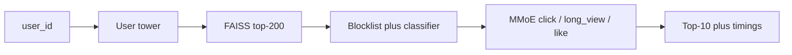

# ReelRank

Two-stage short-video recommender on **KuaiRand-Pure**: retrieve → safety filter → MMoE rank → top-10.

The system is judged primarily by **NDCG@10 (long_view)** on the unbiased **random-exposure log**, not the production feed log.



## Setup

```bash
python -m pip install -e ".[dev]"
make data          # downloads KuaiRand-Pure + captions (not committed)
make baselines
make train-retrieval
make train-ranker
make train-safety  # uses OPENAI_API_KEY if set; otherwise heuristic labels
make eval
make serve         # http://127.0.0.1:43123/recommend?user_id=...
```

Raw data stays under `data/raw/` and `data/processed/` (gitignored). Metrics land in `results/*.json`; the summary table is generated, not typed by hand:

```bash
python -m reelrank.eval.make_readme_table
```

See [results/RESULTS_TABLE.md](results/RESULTS_TABLE.md) after a run.

## Data split

| Split | Source | Rule |
|---|---|---|
| Train | standard log | `date <= 20220421` |
| Val | standard log | `20220422–20220428` |
| Test (std) | standard log | `date > 20220428` |
| Test (primary) | **random log** | full held-out unbiased set |

Labels: `is_click`, `long_view`, `is_like`; `is_hate` used only as a sanity check for safety scores.

## Stack

PyTorch two-tower (in-batch softmax + logQ) → FAISS Flat/HNSW → caption safety (rules + char TF-IDF LR) → MMoE multi-task ranker → FastAPI.

## Serving

```bash
curl "http://127.0.0.1:43123/recommend?user_id=1&k=10"
make loadtest
```

Docker (after artifacts exist):

```bash
docker build -t reelrank .
docker run --rm -p 43123:43123 reelrank
```

## Latest logged numbers (from `results/`)

| Stage | Result |
|---|---|
| Retrieval | Two-tower **Recall@200 = 0.063** vs ItemCF **0.059** vs popularity **0.054** |
| ANN | HNSW recall vs Flat **0.982**; HNSW p99 **~0.07 ms**/query on this VM |
| Ranking | MMoE long_view **GAUC 0.581** (LR click GAUC 0.586; DeepFM weaker on this split) |
| End-to-end | NDCG@10 (long_view, random log): two-tower→MMoE **0.0046** vs popularity→MMoE **0.0029** (**+59%** relative) |
| Safety | Heuristic/weak labels (no `OPENAI_API_KEY` in this run); classifier F1 **0.24**, hate-rate corr **0.13** |
| Serving | Loadtest on cloud VM (4×CPU): p50 **98 ms**, p99 **142 ms**, **~40 QPS** |

Absolute NDCG on the random-exposure log is low by design — that set is hard. The useful claim is the **lift vs the popularity floor on the same cascade**.

## Integrity

Every number above comes from a logged `results/<run_id>.json` with config hash, seed, and git SHA. Do not hand-edit metrics.

Human spot-check of 200 captions (`artifacts/safety_human_spotcheck.csv`) is left for you offline — fill `human_label` and compute Cohen’s kappa when ready. Set `OPENAI_API_KEY` before `make train-safety` to replace heuristic labels with an LLM judge.
