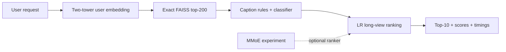

# ReelRank

A reproducible short-video recommendation prototype on **KuaiRand-Pure**: two-tower retrieval → caption safety filter → ranking → top-k API.

The project compares simple and neural models, tests training/serving consistency, and records both successful and unsuccessful experiments. **LR is the default serving ranker**, chosen by long-view GAUC on standard validation; DeepFM and MMoE remain comparison models. All rankers receive the same train-fitted features. LR has additive effects, so user features change probabilities but do not alone change its item ordering; two-tower retrieval provides personalized candidates. DeepFM/MMoE can learn user–item interactions.




## Quickstart

Use Python 3.12 and [uv](https://docs.astral.sh/uv/). Run from the repository root:

```bash
uv sync --extra dev --locked
make test
make example
```

The example fits a tiny ranker on synthetic interactions, filters a candidate list, and prints recommendations using the same scoring code as the API. It downloads no data, writes no model artifacts, and makes no quality claim.

## Results

The authoritative current records are [the generated table](results/RESULTS_TABLE.md), [the executed analysis notebook](notebooks/analysis.ipynb), and [the work log](docs/WORK_LOG.md). Earlier audit reports preserve historical failures and results; they are not the latest scorecard.

- Corrected two-tower Recall@200: **0.06956**, versus popularity **0.05842** and ItemCF **0.05350** on a matched cohort. These are single-seed point estimates.
- Standard-validation long-view GAUC: **LR 0.64845**, DeepFM **0.64390**, MMoE **0.61726**. This supports the simpler default. MMoE is an evaluated experiment, not a claimed architecture win.
- Exact FAISS is the default at this candidate-pool size. HNSW remains a benchmark, not an assumed speed improvement.
- LR cascade with safety: NDCG@10 **0.003587** versus popularity→LR **0.002790**, a **+28.5% exploratory point estimate**. The paired absolute-difference interval **[-0.000265, +0.001892] crosses zero**; this does not establish reliable superiority.
- Recorded 60-second serving run: **2,890 requests, zero failures, 48.36 QPS, p99 100 ms**, eight clients on macOS ARM with think time. This is achieved throughput, not capacity.

## Reproduce the experiment

After installing dependencies:

```bash
make data                       # download KuaiRand, create splits and features
make baselines                  # popularity and ItemCF
make train-retrieval             # two-tower model and FAISS index
make train-ranker                # LR, DeepFM, MMoE
make train-safety                # see optional paid labeling below
make eval                       # LR, safety on/off, paired intervals
make eval RANKER=mmoe
make serve                      # port 43123; LR and exact FAISS
```

In another terminal:

```bash
curl 'http://127.0.0.1:43123/recommend?user_id=1&k=10'
make loadtest
```

Full reproduction requires downloading data and training models; it is separate from the quickstart. Data and artifacts are not included in Git. Python/pip users can instead create and activate a virtual environment and run `python -m pip install -e '.[dev]'`; this does not use the uv lockfile.

`make train-safety` uses paid LLM labeling if `OPENAI_API_KEY` is set; otherwise it falls back to rules. To explicitly use the no-key path, run `env -u OPENAI_API_KEY make train-safety`. This produces different labels from the recorded LLM-source experiment. Serving never calls an LLM. See the [evaluation and safety limitations](docs/evaluation.md).

To serve MMoE, use `make serve RANKER=mmoe`. Old checkpoints without the saved feature transformer require retraining. See [reference defaults](docs/reference-defaults.md) and each module's `--help`; settings come from CLI arguments and Make variables.

## Repository map

| Path | Purpose |
|---|---|
| `reelrank/data/` | Downloading, splits, features, chronological histories |
| `reelrank/retrieval/` | Two-tower training, baselines, FAISS search |
| `reelrank/ranking/` | Shared feature contract, LR/DeepFM/MMoE, scoring |
| `reelrank/safety/` | Caption rules, labeling, classifier, filtering |
| `reelrank/eval/` | Metrics, cascade evaluation, immutable run records |
| `reelrank/serve/` | FastAPI application and load tests |
| `tests/`, `examples/` | Regression tests and a synthetic walkthrough |
| `results/`, `notebooks/` | [Results index](results/README.md) and analysis |
| `docs/`, `scripts/` | Methodology, work log, notebook/demo generation |

## Docker and local storage

Build the application image after installing Docker. Generate data and artifacts with the commands above before starting the service:

```bash
docker build -t reelrank .
docker run --rm -p 43123:43123 \
  --mount "type=bind,src=$(pwd)/artifacts,dst=/app/artifacts,readonly" \
  --mount "type=bind,src=$(pwd)/data/processed,dst=/app/data/processed,readonly" \
  reelrank
```

The image excludes datasets, model artifacts, and experiment archives. `REELRANK_DATA_DIR`, `REELRANK_ARTIFACTS_DIR`, and `REELRANK_RESULTS_DIR` override storage directories; set them before starting Python. Source checkouts default to repository-local directories; installed packages default to the current working directory.

## Further reading

- [Evaluation protocol and limitations](docs/evaluation.md)
- [Results and provenance](results/README.md)
- [Implementation work log](docs/WORK_LOG.md)
- [Interview discussion notes](docs/interview-notes.md)
- [KuaiRand dataset documentation](https://kuairand.com/)

Code is released under the [MIT license](LICENSE). Dataset and third-party model licenses remain separate.
